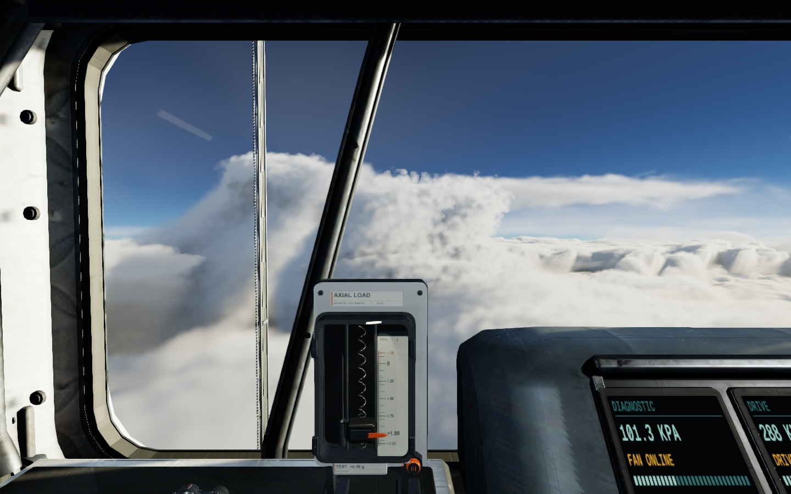

# Upwell

Board Car 07 at an equatorial ocean terminal and ride a space elevator 35,786 km to Aster Reach, a rotating O’Neill colony. A tug tends the pier as you leave. By the time the carriage reaches the dock, you can let go of a flask and push off a handrail to catch it.

**[Download Upwell for Windows](https://github.com/emollick/upwell/releases/latest/download/Upwell-Windows.zip)** · [Play in your browser](https://upwell-tetherline.netlify.app/) · [Watch the one-minute gameplay film](https://upwell-tetherline.netlify.app/media/upwell-cloud-passage.mp4)

## First ride

On 64-bit Windows, extract the whole ZIP to one folder and open `Upwell.exe`. Choose **Guided** for a six-minute crossing or **Real ship time** for 58 hours and 43 minutes aboard. The onboard clock shows the current pace. Your hands, the loose equipment, and the water in the galley respond in real time at either setting.

Walk with **WASD**, look with the mouse, and press **E** to use a fitting. **M** opens the passage timetable. Jump to **Crest the cloud deck** to catch the last twelve seconds inside the bank, or to **Stargazing window** to dim the saloon during orbital night. **K** takes a photograph and **J** opens your journal. [Passenger guide](docs/passenger-guide.md)

## Build or explore the project

- **Unity** — In Unity Hub, open `unity/` with **Unity 6000.5.2f1**. The scene is `Assets/Upwell/Car07.unity`. With Windows Build Support installed, choose **Upwell → Build Windows player**. The executable is written to `unity/Build/Upwell.exe`. Run `python unity/Tools/package-windows.py` from the repository root to package it for distribution.
- **Blender** — Open `blender/Upwell.blend` for the carriage. The harbor vessels, colony, docking equipment, and fracture tester have separate `.blend` files under `blender/`. The authoring scripts are in `source/`. [Prop manifest](PROP-MANIFEST.md)
- **Browser** — Run `python -m http.server 8080 --directory web` from the repository root and open `http://localhost:8080`. The lightweight edition includes its models and renderer. To compile the Unity edition, install Unity’s Web Build Support and choose **Upwell → Build WebGL player**. [Play the hosted Unity edition](https://upwell-tetherline.netlify.app/unity/)

## Art and data

The repository includes prop reference images, masks, surface maps, and their production manifests. Generative AI contributed to the reference art and code. The material library includes photographic scans from Poly Haven. The Earth and sky use geographic imagery, satellite weather measurements, and a star catalogue. [Surface sources](art/surface-scans/sources.json) · [Earth, weather, and sky credits](web/assets/planet/LICENSE.md) · [Habitat imagery](art/orbital-valley/sources.json)

The browser player bundles Three.js, meshoptimizer, and the Geist fonts. [Three.js notice](web/assets/vendor/THREE-LICENSE.txt) · [meshoptimizer notice](web/assets/vendor/MESHOPT-LICENSE.txt) · [Geist license](web/assets/fonts/Geist-license.txt)
